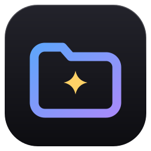

<p align="center">
  
</p>

# Vitrine para Nautilus

**Modo Colunas, painel de pré-visualização, visualização por pasta e "Meu computador" para o Arquivos (Nautilus) do GNOME, inspirados no Finder do macOS, sem perder nenhuma função nativa.**


<!-- Capturas de tela: salve as imagens em docs/ e descomente as linhas abaixo.


-->

A Vitrine é uma extensão para o **Nautilus 51** (e, em princípio, o 50). Ela acrescenta ao gerenciador de arquivos do GNOME recursos que fazem falta para quem vem do macOS ou do Windows:

- 🗂️ **Modo Colunas**: navegue pelas pastas em colunas, como no Finder.
- 🖼️ **Painel de pré-visualização**: veja imagens, textos, vídeos, PDFs e pastas ao lado da lista, sem abrir nada.
- 📌 **Visualização por pasta**: cada pasta lembra se você prefere lista, ícones, ícones grandes ou colunas.
- 🍎 **Estilo Finder** (padrão): barra de ferramentas em cápsulas, título da pasta, seletor de visualização e barra lateral no estilo do Finder do macOS. Dá para voltar ao **Nautilus padrão** a qualquer momento.
- 💻 **Meu computador**: suas pastas, discos e dispositivos numa página só, com o espaço livre de cada um e aviso quando um pen drive é conectado.

A diferença em relação a outras soluções é o **modo híbrido**. A pasta atual continua sendo exibida pela **própria lista do Nautilus**, então menu de contexto, renomear, arrastar e soltar, recortar e colar, Desfazer, scripts e outras extensões funcionam exatamente como antes. A Vitrine só acrescenta coisas; não substitui nada.

---

## Recursos

### 🍎 Estilo da janela: Finder (macOS) ou Nautilus padrão

O estilo **Finder** vem ligado de fábrica. Troque em **☰ da linha Meu computador → Personalizar → Estilo da janela**; vale na hora, em todas as janelas.

- Barra de ferramentas: **← →** numa cápsula e o **nome da pasta** em negrito; à direita, **Visão em grade / Visão em lista / Colunas / Galeria**, **Ordenar e agrupar** (A-Z, Z-A, última e primeira modificação, tamanho, tipo; agrupar na Galeria), **Etiquetas**, **Compartilhar** (copiar local, enviar por e-mail, Bluetooth, compartilhamento na rede), **⋯** (nova pasta, documento vazio, propriedades, renomear, comprimir, copiar, colar, mover para a lixeira, arquivos ocultos, painel de pré-visualização, pesquisar em todos os lugares) e **Pesquisar**.
- A barra de caminho aparece ao editar o local (**Ctrl+L**) ou ao pesquisar.
- Opcionais (em *Personalizar → Estilo Finder*): **barra de caminho** embaixo, clicável, e **barra de status** com a quantidade de itens e o espaço disponível.
- Barra lateral com ícones na cor de destaque do sistema e seleção cinza arredondada.
- Os nomes seguem os do GNOME (a Vitrine usa a tradução do próprio Nautilus). Os botões de fechar, minimizar e maximizar ficam no padrão do GNOME.
- **Visão em grade:** dimensões das imagens (ex.: *1.066 × 1.599*) em azul abaixo do nome, seleção cinza arredondada. O nome longo já é truncado no meio pelo próprio Nautilus.
- **Visão em lista:** linhas alternadas suaves.
- **Nautilus padrão** remove tudo o que o estilo Finder acrescentou (CSS, botões, sinais). Colunas, pré-visualização e Meu computador continuam conforme as suas opções.


### 🖼️ Galeria

Ative com **Ctrl+4**, com o botão da Galeria (estilo Finder) ou em **Visualização desta pasta → Galeria**.

- Imagem grande do item selecionado, faixa de miniaturas rolável embaixo e painel com nome, tipo, tamanho, dimensões, datas e etiquetas.
- **Agrupar** a faixa por data de modificação (*Hoje, Ontem, Últimos 7 dias, Últimos 30 dias*, meses e anos), tipo, tamanho ou etiqueta, pelo menu *Ordenar e agrupar*.
- Setas navegam; **Enter** abre; **Espaço** abre a visualização rápida. A seleção vai para a lista nativa do Nautilus, então Propriedades, Renomear, Comprimir e Mover para a lixeira (clique direito ou menu ⋯) agem no item da Galeria.
- A escolha da Galeria é lembrada por pasta, como as outras visualizações.

### 🗂️ Modo Colunas

- Ative com **Ctrl+3** ou com o botão de colunas na barra superior.
- As pastas anteriores do caminho aparecem como colunas à esquerda, com o item do caminho destacado. A pasta atual fica na lista nativa do Nautilus, à direita.
- Clique numa pasta de qualquer coluna para ir até ela. Navegar com as setas do teclado funciona.
- Clique num arquivo de uma coluna anterior para abrir a pasta dele **já com o arquivo selecionado** na lista nativa, com todas as ações do Nautilus disponíveis.
- **Arraste e solte** entre colunas, da coluna para a lista e da lista para a coluna. Mover e copiar usam as operações do próprio Nautilus, com barra de progresso, diálogo de conflito e **Ctrl+Z**.
- Clique do meio numa pasta abre em nova janela. O clique direito traz Abrir, Abrir em nova janela, Mostrar na lista, Copiar caminho e Mover para a lixeira.
- Respeita a opção de **mostrar arquivos ocultos** do Nautilus.

### 🖼️ Painel de pré-visualização

Ative com **Ctrl+Shift+P** ou com o botão de painel. A largura pode ser ajustada arrastando a borda e fica salva.

| Seleção | O que o painel mostra |
|---|---|
| Imagem | A imagem com rotação EXIF correta, dimensões, tipo, tamanho e datas |
| Texto / código | O conteúdo, em fonte monoespaçada (até 400 linhas) |
| Vídeo, PDF, documentos | A miniatura do sistema (gerada na hora, se ainda não existir) |
| Pasta | A lista do conteúdo, com contagem de pastas e arquivos. Clique para entrar |
| Vários itens | A quantidade de itens e o tamanho total |
| Nada selecionado | As informações da pasta atual |

O botão **Abrir** usa o aplicativo padrão. O botão 👁 (ou a tecla **Espaço**) abre a visualização rápida do GNOME (Sushi).

**Rápido de verdade.** No Fedora 45 o carregador de imagens do sistema (glycin) abre um processo isolado para cada imagem. A Vitrine contorna isso:

- mostra a miniatura já existente na hora;
- decodifica JPEG, PNG e TIFF com o decodificador do GTK, lendo dimensões e rotação direto do cabeçalho;
- guarda em cache as imagens já vistas;
- pré-carrega as imagens vizinhas.

| Situação (medida no Nautilus 51) | Primeira imagem | Imagem nítida |
|---|---|---|
| Foto nova | ~40 ms | ~190 ms |
| Foto vizinha (pré-carregada) | ~38 ms | ~38 ms |
| Foto já vista | ~37 ms | ~37 ms |

### 📌 Visualização por pasta

- Trocou de visualização numa pasta, com **Ctrl+1** (lista), **Ctrl+2** (ícones), **Ctrl+3** (colunas), os botões ou o menu? A Vitrine **lembra a escolha para aquela pasta**. Pastas sem regra usam o seu padrão.
- O **zoom dos ícones também é salvo por pasta**: ícones gigantes em *Imagens*, ícones normais em *Downloads*.
- **Pastas de fotos e vídeos são detectadas automaticamente.** Se a maioria dos arquivos for imagem ou vídeo, a pasta abre em ícones grandes.
- **Descoberta automática de pastas** (opcional, desligada por padrão): olha o tipo dos arquivos de cada pasta e escolhe a visualização. Maioria de fotos/vídeos → ícones extra grandes; maioria de documentos e outros arquivos → lista; pasta mista ou vazia → o seu padrão. Só lê o nome/extensão de até 200 itens (rápido mesmo em pastas enormes) e guarda o resultado até a pasta mudar. Uma escolha feita à mão numa pasta sempre vence a descoberta. Ligue no menu **Visualização desta pasta** ou em **Personalizar** (menu ☰ da linha Meu computador).
- Na primeira execução, *Imagens* e *Vídeos* já vêm configuradas para ícones grandes, **incluindo as subpastas**.
- Navegando em colunas, as subpastas continuam em colunas.

Clique com o botão direito no **fundo de qualquer pasta** e escolha **Visualização desta pasta**:

- Lista · Ícones · Ícones grandes · Colunas
- Aplicar também às subpastas / Não aplicar às subpastas
- Esquecer esta pasta (usar o padrão)
- Ligar/desligar a descoberta automática de pastas
- Usar a visualização atual como padrão
- Mostrar/ocultar pré-visualização

### 🏷️ Etiquetas coloridas

Vermelho, Laranja, Amarelo, Verde, Azul e Roxo, além das que você criar.

- Gravadas no atributo estendido padrão **`user.xdg.tags`** (o mesmo de outros gerenciadores de arquivos, como o Dolphin): continuam valendo fora da Vitrine.
- **Aplicar:** clique direito → *Etiquetas*, botão de etiqueta na barra de ferramentas (estilo Finder) ou arrastando arquivos para a etiqueta na barra lateral. Vários arquivos e várias etiquetas por arquivo.
- **Ver:** bolinhas coloridas nos ícones (grade, lista e colunas), coluna **Etiquetas** na lista (ligue em *Colunas visíveis* do Nautilus) e a seção **Etiquetas** da barra lateral, que mostra os arquivos de cada etiqueta.
- **Todas as etiquetas…:** criar, renomear, trocar a cor e apagar. Renomear e apagar atualizam os arquivos que a Vitrine conhece.
- Arquivos etiquetados por outros programas aparecem depois de abertos no Nautilus, ou com *Procurar na pasta pessoal* na página da etiqueta.
- Pen drives FAT/exFAT e alguns compartilhamentos de rede não aceitam atributos estendidos; a Vitrine avisa.

### 💻 Meu computador

Abra pela entrada **Meu computador** no topo da barra lateral, com **Ctrl+Shift+C** ou pelo clique direito no fundo de uma pasta.

- **Pastas**: tudo o que está na barra lateral do Nautilus, com os mesmos nomes, numa grade única: primeiro a Pasta pessoal, depois Documentos, Downloads, Imagens, Músicas e Vídeos, em seguida as demais pastas fixadas em ordem alfabética e, por fim, Recentes, Favoritos, Rede e Lixeira. Fixou ou removeu uma pasta da barra lateral? O Meu computador acompanha.
- **Dispositivos e unidades**: disco do sistema, outros discos, pen drives, HDs externos, cartões de memória e celulares, cada um com **barra de uso** (azul, laranja acima de 80%, vermelha acima de 92%) e "X livres de Y · sistema de arquivos". O uso é atualizado a cada 10 segundos enquanto a página está aberta.
- **Rede**: compartilhamentos montados (SMB, SFTP, WebDAV…), quando houver.
- **Dispositivos não montados** aparecem também. Ao abrir, a Vitrine monta o dispositivo e pede a senha se ele for criptografado.
- **Remover com segurança**: botão ⏏ no card ou clique direito → *Remover com segurança* / *Desmontar*. Um aviso confirma quando já dá para tirar o dispositivo.
- **Selecionar o card** mostra o conteúdo do disco no painel de pré-visualização. Abrir segue o clique simples ou duplo configurado no Nautilus.
- Atalho para o app **Discos**, para formatar e particionar.

**Dispositivo novo conectado?** Assim que um pen drive, HD externo ou cartão é inserido, aparece um aviso na janela do Nautilus (*"Pen drive conectado — Abrir"*). O card dele ganha o selo **Novo**, fica destacado e já vem **selecionado** na página Meu computador.

A página fecha sozinha quando você navega para qualquer lugar: barra lateral, barra de caminho ou busca.

**Voltar e Avançar funcionam como num navegador.** O Meu computador entra no histórico de cada aba: Meu computador → Imagens → **Voltar** leva de volta ao Meu computador, e **Avançar** volta para Imagens. Vale para os botões ← →, **Alt+←** / **Alt+→** e os botões laterais do mouse. Se o Meu computador for o primeiro lugar da janela, o Voltar fica desativado enquanto ele estiver aberto. Cada aba tem o seu próprio histórico, e trocar de aba mostra o Meu computador se ele for o lugar atual daquela aba.

**Personalizar:** o menu ☰ na linha **Meu computador** da barra lateral (ou clique direito num item → *Personalizar…*) abre uma tela para:

- **Abrir o Nautilus no Meu computador**: ao abrir o Arquivos pelo menu de aplicativos ou numa janela nova (Ctrl+N), ele começa aqui. Se outro programa pedir uma pasta específica, ela é respeitada.
- Mostrar ou esconder a entrada **Meu computador na barra lateral**.
- Ligar ou desligar o **aviso de dispositivo novo**.
- Escolher quais **seções** aparecem: Pastas, Dispositivos e unidades, Rede e o atalho para o Discos.
- Escolher **item por item** o que aparece. Também dá para ocultar direto pelo clique direito → *Ocultar do Meu computador*.
- **Mostrar tudo de novo**, com um clique.

O mesmo menu ☰ tem **Sobre a Vitrine** (versão, link do repositório e créditos), que também aparece no clique direito no fundo de uma pasta.

---

## Instalação

### Requisitos

- **Nautilus 51** (GNOME 51, Fedora 45), versão em que a extensão foi testada. O Nautilus 50 (Fedora 44) tem a mesma estrutura de janela e deve funcionar, mas ainda não foi testado. Outras distribuições com essas versões também devem funcionar.
- `nautilus-python` (o instalador oferece instalar).

### Opção 1 (recomendada): clonar o repositório

```bash
git clone https://github.com/bispov19/nautilus-vitrine.git
```

```bash
cd nautilus-vitrine && ./install.sh
```

O `install.sh` instala o `nautilus-python` se faltar (pede sua senha), copia a extensão para `~/.local/share/nautilus-python/extensions/` e reinicia o Nautilus. Para atualizar depois: `git pull && ./install.sh`.

### Opção 2: script único

O arquivo `criar-vitrine.sh` contém o projeto inteiro. Baixe-o e rode:

```bash
bash criar-vitrine.sh --instalar
```

Ele cria a pasta `~/nautilus-vitrine` com todos os arquivos e já instala. Sem `--instalar`, só cria a pasta. Também dá para passar outro destino: `bash criar-vitrine.sh ~/Projetos/vitrine`.

### Em breve: pacote RPM pelo COPR

O pacote RPM já está pronto (`packaging/nautilus-vitrine.spec`), mas **ainda não foi publicado no COPR**. Quando estiver disponível, a instalação será:

```
sudo dnf copr enable bispov19/nautilus-vitrine
sudo dnf install nautilus-vitrine
```

Até lá, use a opção 1 ou 2, ou gere o RPM localmente (veja *Empacotamento*).

### Desinstalar

```bash
./uninstall.sh
```

O Nautilus volta exatamente ao original. Suas regras ficam guardadas; use `./uninstall.sh --purge` para apagar tudo.

> **Não é uma extensão do GNOME Shell.** A Vitrine roda dentro do Nautilus, via nautilus-python, e por isso não aparece no app Extensões nem no extensions.gnome.org. Ela é gerenciada pelos scripts acima.

---

## Atalhos

| Atalho | Ação |
|---|---|
| **Ctrl+3** | Modo Colunas |
| **Ctrl+4** | Galeria |
| **Ctrl+I** | Propriedades (com a aba Etiquetas) |
| **Ctrl+1** / **Ctrl+2** | Lista / Ícones (nativos do Nautilus, agora lembrados por pasta) |
| **Ctrl+Shift+P** | Mostrar/ocultar a pré-visualização |
| **Ctrl+Shift+C** | Abrir/fechar o Meu computador |
| **Alt+←** / **Alt+→** | Voltar / Avançar (incluindo o Meu computador) |
| Botões laterais do mouse | Voltar / Avançar |
| **Espaço** | Visualização rápida (Sushi) |
| **Ctrl + roda do mouse** | Zoom (salvo por pasta na visualização em ícones) |
| Clique do meio numa coluna | Abrir a pasta em nova janela |

---

## Configuração

Tudo funciona sem configurar nada. As preferências ficam no **GSettings** (schema `io.github.bispov19.NautilusVitrine`, que vem dentro da extensão) e valem na hora, até pelo terminal:

```bash
gsettings --schemadir ~/.local/share/nautilus-python/extensions/vitrine/schemas list-recursively io.github.bispov19.NautilusVitrine
```

```bash
gsettings --schemadir ~/.local/share/nautilus-python/extensions/vitrine/schemas set io.github.bispov19.NautilusVitrine window-style nautilus
```

Na primeira execução da versão com GSettings, o antigo `settings.json` é importado e guardado como `settings.json.importado`. Os nomes abaixo usam `-` no GSettings (ex.: `preview-visible`).

| Chave | Padrão | Descrição |
|---|---|---|
| `window_style` | `"finder"` | Estilo da janela: `finder` ou `nautilus` |

| `preview_visible` | `true` | Painel de pré-visualização aberto |
| `preview_width` | `320` | Largura do painel (px), salva ao arrastar a borda |
| `column_width` | `230` | Largura de cada coluna (px) |
| `max_visible_columns` | `3` | Colunas visíveis antes de começar a rolar |
| `remember_per_folder` | `true` | Lembrar a visualização escolhida em cada pasta |
| `auto_media_grid` | `true` | Abrir pastas de fotos/vídeos em ícones grandes |
| `auto_media_zoom` | `"extra-large"` | Zoom usado nessas pastas |
| `auto_media_ratio` | `0.6` | Proporção mínima de mídia para considerar "pasta de fotos" |
| `folder_discovery` | `false` | Descoberta automática de pastas (mídia → ícones extra grandes, documentos → lista). Usa também `auto_media_zoom` e `auto_media_ratio` |
| `default_mode` | do Nautilus | Visualização das pastas sem regra: `list`, `grid` ou `columns` |
| `default_grid_zoom` | do Nautilus | Zoom padrão dos ícones |
| `start_on_computer` | `false` | Abrir o Nautilus já no Meu computador (quando abre na pasta pessoal) |
| `computer_in_sidebar` | `true` | Entrada "Meu computador" no topo da barra lateral |
| `computer_sections` | `{}` | Seções desligadas, ex.: `{"network": false}` (`places`, `devices`, `network`, `disks_button`) |
| `computer_hidden` | `[]` | Itens ocultos: URIs de locais (`"trash:///"`) ou chaves de dispositivos |
| `notify_new_devices` | `true` | Avisar quando um pen drive, HD externo ou cartão for conectado |
| `tags` | 6 cores | Etiquetas: lista de (nome, cor); cores `red`, `orange`, `yellow`, `green`, `blue`, `purple`, `gray` |
| `tags_in_sidebar` | `true` | Seção Etiquetas na barra lateral (estilo Finder) |
| `image_dimensions` | `true` | Dimensões das imagens abaixo do nome na grade (estilo Finder) |
| `gallery_group_by` | `"date"` | Agrupamento da Galeria: `none`, `date`, `type`, `size`, `tags` |
| `path_bar` | `false` | Barra de caminho embaixo (estilo Finder) |
| `status_bar` | `false` | Barra de status embaixo (estilo Finder) |

**`~/.config/nautilus-vitrine/folders.json`** guarda as regras por pasta:

```json
{
  "file:///home/voce/Imagens": { "mode": "grid", "zoom": "extra-large", "recursive": true },
  "file:///home/voce/Projetos": { "mode": "columns" }
}
```

Zooms válidos: `small`, `small-plus`, `medium`, `large`, `extra-large`.

---

## Como funciona

O Nautilus não tem API pública para novas visualizações ou painéis. Assim como o [My Computer for Nautilus](https://github.com/yannmasoch/nautilus-my-computer), a Vitrine roda dentro do processo do Nautilus (via nautilus-python) e insere seus widgets na janela em tempo de execução. Para quebrar o mínimo possível com atualizações do GNOME:

- **Poucos pontos de injeção.** Só o conteúdo do `AdwToolbarView` que contém as abas é envolvido por `[colunas | abas do Nautilus ou Meu computador] ‖ [pré-visualização]`. A entrada "Meu computador" entra na barra lateral pela API pública `AdwToolbarView.add_top_bar`, sem mover nenhum widget do Nautilus. O resto da janela fica intocado.
- **Dispositivos pelo GIO.** A página e os avisos usam o `Gio.VolumeMonitor` (o mesmo serviço que o Nautilus usa), e montar, desmontar e ejetar passam por `Gtk.MountOperation`, com o diálogo de senha do sistema.
- **Nada do Nautilus é reimplementado.** A pasta atual é sempre a lista nativa, e a seleção é lida do próprio `NautilusViewModel`.
- **Sem referências fortes.** Widgets e modelos do Nautilus nunca são mantidos vivos pela extensão; o modelo de seleção é acompanhado por *weak reference*.
- **Operações nativas.** Mover, copiar e lixeira passam pela API D-Bus `org.gnome.Nautilus.FileOperations2`, com progresso, conflitos e Desfazer.
- **Voltar/Avançar com o Meu computador.** O Meu computador fica *por cima* da lista do Nautilus, então o histórico nativo não sabe dele. Cada aba guarda um histórico próprio (`history.py`) em que cada entrada lembra em que ponto do histórico do Nautilus estava. Os botões ← →, os atalhos Alt+←/→ e os botões do mouse passam por esse histórico; quando o destino é uma pasta, a Vitrine pede ao Nautilus o Voltar/Avançar nativo, e quando é o Meu computador, só mostra a página.
- **Falha segura.** Se uma versão futura do Nautilus mudar a estrutura da janela, a Vitrine simplesmente não se injeta e registra o motivo no log. Exceções em callbacks também viram log, sem derrubar o Nautilus.

### Estrutura do código

```
nautilus-vitrine.py     ponto de entrada carregado pelo nautilus-python
vitrine/
  main.py               descobre as janelas, CSS, menu "Visualização desta pasta"
  window.py             injeção por janela, botões, atalhos, regras por pasta
  columns.py            Modo Colunas (Gtk.DirectoryList + ListView)
  preview.py            painel de pré-visualização
  imageload.py          carregamento rápido de imagens, cache e pré-carregamento
  computer.py           página Meu computador e monitor de dispositivos
  config.py             preferências (GSettings) e regras por pasta (JSON)
  finder/               estilo Finder: aplica e remove a camada visual (barra de ferramentas, barras de baixo)
  schemas/              schema GSettings da Vitrine
  tags.py               etiquetas (user.xdg.tags) e índice dos arquivos etiquetados
  gallery.py            visualização em Galeria (Ctrl+4)
  tagui.py              telas das etiquetas (barra, barra lateral, página, Todas as etiquetas…)
  history.py            Voltar/Avançar por aba incluindo o Meu computador (sem GTK)
  about.py              página "Sobre" do diálogo de personalização
  assets/               logo, ícone simbólico e CSS da página Sobre
  native.py             ponte com o Nautilus (slot, lista/grade, seleção)
  util.py               log, varredura de widgets, operações D-Bus
  selftest.py           autoteste dentro do Nautilus real
tools/
  smoke_test.py         colunas, preview e página Sobre fora do Nautilus
  test_history.py       testes do histórico de Voltar/Avançar
  test_config.py        testes das preferências (GSettings)
  test_tags.py          testes das etiquetas
  test_gallery.py       testes dos grupos de data da Galeria
  build_bootstrap.py    gera o criar-vitrine.sh
packaging/
  nautilus-vitrine.spec receita do pacote RPM
.copr/Makefile          build automático no COPR
```

---

## Desenvolvimento

```bash
./install.sh --dev
```

O modo dev usa links simbólicos: edite o código e só reinicie o Nautilus (`nautilus -q`).

O projeto inclui tarefas do **VS Code** (*Terminal → Run Task*):

| Tarefa | O que faz |
|---|---|
| **Ctrl+Shift+B** | Instala em modo dev e reinicia o Nautilus |
| Autoteste dentro do Nautilus | Verificações automáticas: injeção, colunas, preview, regras por pasta, zoom, tempo de carregamento das imagens, Meu computador (locais da barra lateral, uso de disco, aviso de dispositivo novo, personalização, página Sobre, abrir direto nele) e Voltar/Avançar. Roda com regras temporárias; as suas e o zoom são restaurados no fim |
| Rodar em modo depuração | `VITRINE_DEBUG=1 VITRINE_DUMP=1 nautilus` (inclui a árvore de widgets da janela no log) |
| Acompanhar log | `tail -f ~/.cache/nautilus-vitrine/vitrine.log` |
| Teste fora do Nautilus | Abre colunas, preview e a página Sobre numa janela própria |
| Gerar script único | Atualiza o `criar-vitrine.sh` |

Os testes do histórico de Voltar/Avançar rodam sem o Nautilus:

```bash
python3 tools/test_history.py
```

Para rodar o autoteste pelo terminal:

```bash
nautilus -q; VITRINE_SELFTEST=1 nautilus --new-window ~ &
```

Depois de alguns segundos, veja o resultado:

```bash
grep SELFTEST ~/.cache/nautilus-vitrine/vitrine.log
```

### Empacotamento (RPM / COPR)

```bash
sudo dnf install make rpm-build python3-devel
```

```bash
make rpm
```

O RPM sai em `dist/`; `make install-rpm` instala. A receita fica em `packaging/nautilus-vitrine.spec`.

O COPR gera o pacote direto deste repositório usando `.copr/Makefile`. Configuração única em [copr.fedorainfracloud.org](https://copr.fedorainfracloud.org):

1. Entre com a conta Fedora e crie o projeto `nautilus-vitrine`, marcando os *chroots* `fedora-45-x86_64` e `fedora-44-x86_64` (e outros que quiser).
2. Em **Packages → New package → SCM**: *Clone URL* `https://github.com/bispov19/nautilus-vitrine`, *Spec file* `packaging/nautilus-vitrine.spec`, *SRPM build method* **make srpm**.
3. Clique em **Rebuild**. Para gerar automaticamente a cada `git push`, ative o *webhook* do GitHub em **Settings → Integrations** do projeto COPR.

Para lançar uma versão nova: aumente `Version` e acrescente uma entrada no `%changelog` do `.spec`, mude `__version__` em `vitrine/__init__.py` para o mesmo número (o `smoke_test.py` avisa se ficarem diferentes), faça o commit e o push.

---

## Solução de problemas

- **Nada mudou no Nautilus:** confira se o `nautilus-python` está instalado (`rpm -q nautilus-python`), feche o Nautilus por completo (`nautilus -q`) e abra de novo.
- **Algo estranho aconteceu:** veja `~/.cache/nautilus-vitrine/vitrine.log`. A linha `janela injetada com sucesso` confirma que a extensão carregou. Se o log apontar que o TabView não foi encontrado, a estrutura do Nautilus mudou: abra uma *issue* com o log.
- **Quer voltar ao Nautilus original:** `./uninstall.sh`.

## Limitações conhecidas

- A extensão usa estruturas internas do Nautilus, que podem mudar a cada versão do GNOME. Foi testada no Nautilus 51.1 (Fedora 45).
- Nas colunas anteriores o menu de clique direito é reduzido. Para o menu completo, use **Mostrar na lista**.
- O zoom dos ícones é uma preferência global do Nautilus. Ao entrar numa pasta com zoom salvo, outras janelas abertas em ícones acompanham.
- Locais especiais (Recentes, Favoritos, Lixeira, Rede, Pesquisa) mantêm o comportamento padrão do Nautilus.
- A coluna **Etiquetas** não é ligada automaticamente: mudar as colunas padrão com a janela aberta derruba o Nautilus 51.1. Ligue em *Colunas visíveis*.
- O menu de clique direito das extensões só aceita texto: as etiquetas aparecem num submenu (com 🔴🟠🟡…), não como a linha de bolinhas do macOS.
- Sem desfoque de fundo ("vidro"): o GNOME não desfoca janelas de aplicativos.
- Agrupar com cabeçalhos ("Hoje", "Ontem"…) só existe na Galeria: a grade nativa do Nautilus não aceita cabeçalhos.
- A barra lateral nativa não tem seções recolhíveis; só a seção Etiquetas da Vitrine recolhe.
- Compartilhar usa e-mail, Bluetooth e o compartilhamento na rede do GNOME: o GNOME não tem um portal de compartilhamento como o do macOS.
- "Duplicar" não existe no GNOME e ficou de fora; "Obter informações" é **Propriedades** (Ctrl+I).
- O menu de histórico do botão ← (clique direito ou toque longo) é do Nautilus e não lista o Meu computador. Escolher um item ali funciona; a Vitrine se realinha sozinha.

## Próximos passos

- [x] Pacote RPM (`make rpm`)
- [ ] Publicação no COPR (`dnf copr enable`)
- [ ] Tocar vídeo e áudio direto no painel
- [ ] Folhear páginas de PDF no painel
- [ ] Dados EXIF da foto (câmera, lente, GPS)
- [x] Tela de personalização do Meu computador
- [ ] Tela de preferências geral (colunas, preview, regras por pasta)
- [x] Estilo Finder, etiquetas coloridas e Galeria
- [ ] Pastas inteligentes / pesquisas salvas na barra lateral
- [ ] Agrupar com cabeçalhos também na visão em grade (precisa de suporte do Nautilus)

Sugestões e *pull requests* são bem-vindos.

## Créditos

A técnica de injeção na janela foi inspirada no projeto **[My Computer for Nautilus](https://github.com/yannmasoch/nautilus-my-computer)**, de Yann Masoch (licença MIT).

## Licença

[MIT](LICENSE)
